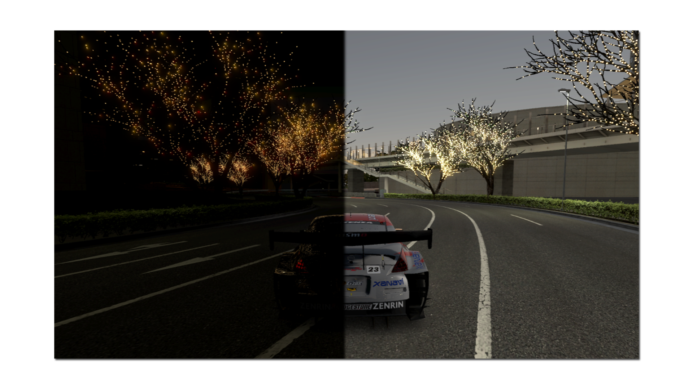

<h4 align="center">ssrMod — A mod that awakens the already desolate, soulless looking variant of Special Stage Route 5.</h4>

Made for all builds, region and build does not matter.

# Installation
- Unpack your game files with [Nenkai's GTToolsSharp.](https://github.com/Nenkai/GTToolsSharp)
- Download the mod in the [releases](https://github.com/0x-60/ssrMod/releases/tag/releasev211) section.
- Extract the mod, make your choice and drag-and-drop the files in `/dev_hdd0/game/BCUS98114/USRDIR/direct/crs/`
- **Optionally**, if you're on a real PS3 or want to port/back-port, repack the game files.
- You can edit `4422FEA58` while on-course, it's a float that dictates time of day, sunniness is between `6.3` and `6.8`.
⠀
⠀
⠀⠀
